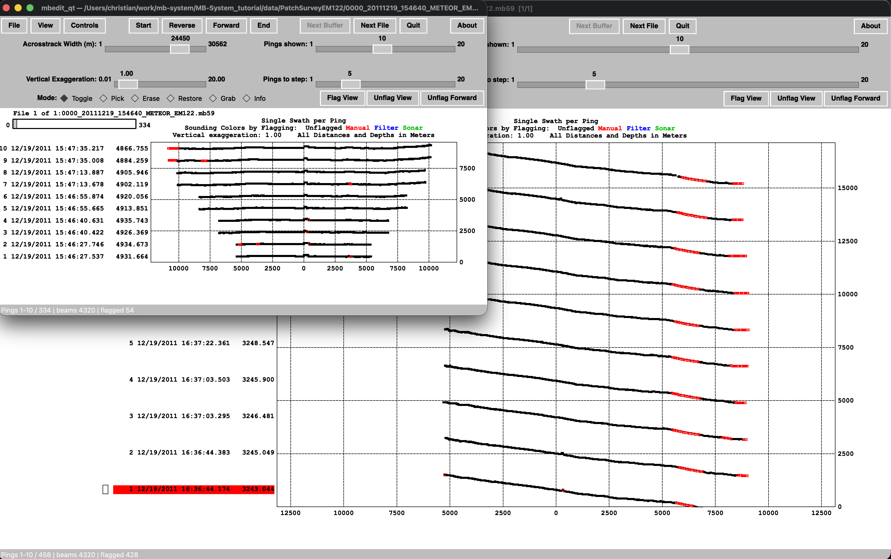

# mbedit_qt

A cross-platform (PySide6/Qt) reimplementation of the swath bathymetry editor



**MBedit** from [MB-System](https://github.com/dwcaress/MB-System).

It edits beam flags in multibeam data and saves them in MB-System's native edit-save-file (`.esf`) format, so `mbprocess` can apply them as usual.

> **Status: 0.5.0 (beta).** The core edit/save workflow works on real EM122 data, but parity with the X11/Motif MBedit is not complete.
> Always keep a backup of your data and compare results with the original MBedit before using this on production data.

## How it works

1. **Input.** The tool reads only **fast-bathymetry (`.fbt`)** files
   (MB-System format 71, `MBF_MBLDEOIH`, V4/V5 records). Given a swath file such
   as `line.mb59`, it uses `line.mb59.fbt`, or runs `mbdatalist -I line.mb59 -O`
   to create it. It never reads or modifies the original swath file.
2. **Datalists.** A datalist (MB-System style, `path format [weight]`, `#`
   comments, nested lists) can be opened; you step through the files with
   *Next File*.
3. **Editing.** Soundings are plotted per ping in the waterfall, along-track or
   across-track view. Edit modes: Toggle, Pick, Erase, Restore, Grab, Info.
   Flag colors: unflagged, manual, filter, sonar.
4. **Saving.** Every edit is appended to `<file>.esf` immediately, with MB-System's
   edit action codes (flag / unflag / zero / filter). An existing `.esf` is copied
   to `.esf.tmp` first. *Done / Next File* closes the `.esf` and runs
   `mbset` to set `EDITSAVEMODE` and `EDITSAVEFILE` in the `.par` file.
5. **Applying edits.** Run `mbprocess -I <file>` yourself, or tick
   *Controls → Run mbprocess on Done/Next File*.

### FBT record layout used

Per ping: record label (2 bytes, `V4`/`V5`), header (90 bytes for V4), then beam flags, depth, across-track, along-track, amplitude, sidescan, sidescan across-track, sidescan along-track. Depths are stored relative to the sonar, so the reader adds the header's sensor depth. The amplitude and sidescan blocks are skipped. This layout was worked out from real EM122 `.fbt` files, not from the format specification. If you see wrong geometry on other sonars, please open an issue with the first 160 bytes of the file (`xxd -l 160 file.fbt`).

## What is implemented

- FBT V4/V5 reader, automatic FBT generation, simple/nested datalist expansion
- ESF read/write, continuous edit logging, `.esf.tmp` backup, `.par` update via `mbset`
- Waterfall, along-track and across-track views; flag-state coloring
- Edit modes Toggle / Pick / Erase / Restore / Grab / Info
- Ping actions: bad / good / left / right / zero ping, Flag View, Unflag View,
  Unflag Forward, flag out-of-bounds
- Filters: median spike, wrong side, cut by beam, by distance, by angle
- Buffer paging, Go-To-Time, annotation (width / exaggeration), file list dialog
- Keyboard shortcuts modeled on the MBedit key macros
- Motif-style layout (`-D` browse mode)
- **Window can be resized** :-)

## Requirements

- Python 3.9 or newer
- `pip install PySide6 numpy matplotlib`
- MB-System on your `PATH` (for `mbdatalist`, `mbset`, `mbprocess`).
  Not needed if you only open `.fbt` files that already exist.

## Running

```bash
python mbedit_qt.py                       # start, then File → Open
python mbedit_qt.py line.mb59.fbt         # one file
python mbedit_qt.py datalist.mb-1         # datalist
python mbedit_qt.py datalist.mb-1 -D      # browse mode (no edits saved)
```

### macOS
```bash
python3 -m venv .venv && source .venv/bin/activate
pip install PySide6 numpy matplotlib
python mbedit_qt.py
```
MB-System installed via Homebrew or from source must be on `PATH`. A harmless `modalSession has been exited prematurely` message may appear in the terminal when dialogs close; it is a Qt/macOS message, not an error in the tool.

### Linux
```bash
python3 -m venv .venv && source .venv/bin/activate
pip install PySide6 numpy matplotlib
python mbedit_qt.py
```
If Qt fails to start, install the XCB libraries (for example
`sudo apt install libxcb-cursor0 libxkbcommon-x11-0`).

### Windows
```powershell
py -m venv .venv
.venv\Scripts\activate
pip install PySide6 numpy matplotlib
python mbedit_qt.py
```
Native MB-System support on Windows is limited. The simplest route is to create the `.fbt` files and run `mbprocess` in WSL or on another machine, and use this tool to edit them. Windows has not been tested.

## Roadmap

Still to do before parity with the X11 MBedit:

- [ ] Read swath files directly through MBIO instead of only `.fbt`
      (all formats, `-F format`, `-B`/`-E` time bounds, other command-line options)
- [ ] Bottom-detect and pulse-type display modes (the `.fbt` carries no such data)
- [ ] Dual-swath handling and multiplicity checks against the X11 behavior
- [ ] Verify along-track view, out-of-bounds handling and label colors against X11
- [ ] Verify filters numerically against MBedit on the same data
- [ ] Lock files, `--use-edit-save` / `-S` and `-X` option behavior
- [ ] Test other FBT sources (V5 records, other sonars)
- [ ] Windows testing, packaging (`pip`, standalone binaries)
- [ ] Automated tests and a regression set of edited files compared to MBedit

## Credits and licence

Based on the design and source of MBedit by D. W. Caress and D. N. Chayes
(MB-System). Reimplemented in Python/Qt6 by C. d. S. Ferreira. Released under the same license as MB-System (GPL-3.0). See `LICENSE`.
